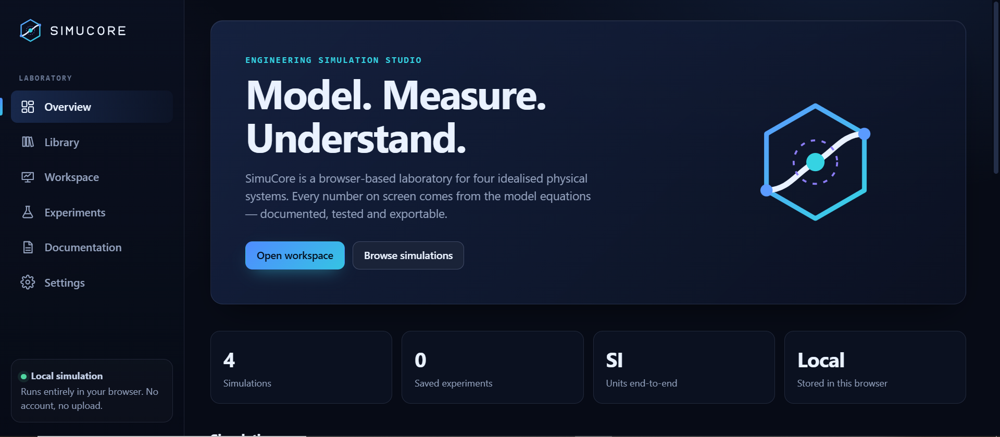
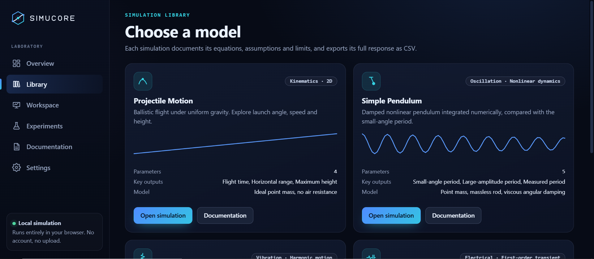
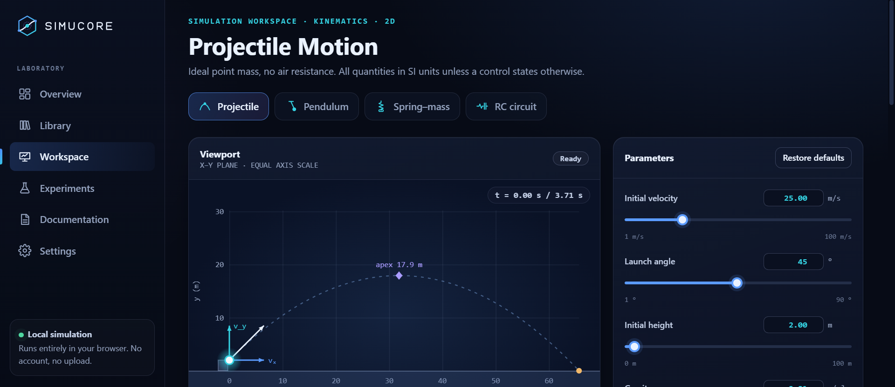
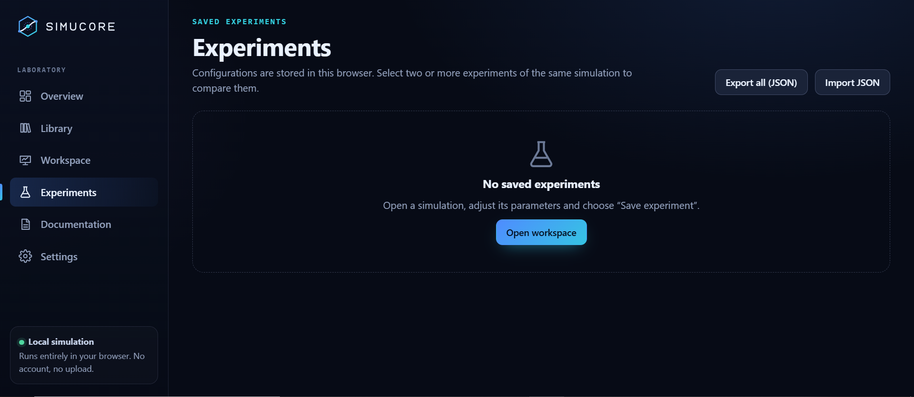
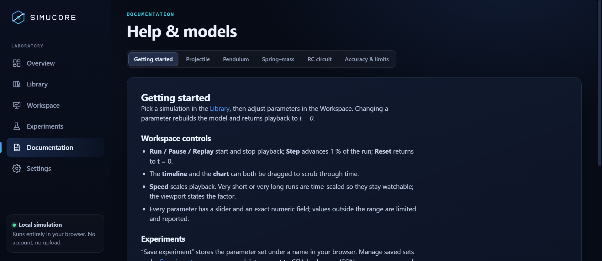
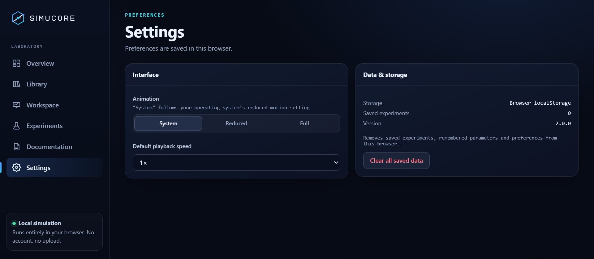

<div align="center">


<br/>


<br/>

**A browser-based engineering simulation studio for exploring projectile motion, pendulums, spring–mass systems, and RC circuits.**

<br/>


<br/><br/>

[Overview](#-overview) • [Features](#-key-features) • [Screenshots](#-screenshots) • [Getting Started](#-getting-started) • [Contributing](#-contributing) • [License](#-license)

</div>

---

<div align="center">

</div>

## 📍 Overview

**SimuCore** is a browser-based engineering simulation studio. It lets users adjust physical parameters, watch the system respond in a live viewport, read measurements in SI units, and analyze the response through charts, equations, and exportable data.

Every number on screen, every chart curve, and every exported CSV row comes from the same documented model. SimuCore runs entirely in the browser with no backend, account, API key, build step, or runtime dependency.

### 🎯 Project Objectives

- Make engineering and physics models interactive and easy to explore.
- Show live measurements, equations, and assumptions beside every simulation.
- Keep calculations transparent, consistent, and in SI units.
- Verify the mathematical models with automated tests.
- Let users save, compare, and export their experiments.
- Provide a responsive, accessible interface that works on desktop, tablet, and mobile.

---

## ✨ Key Features

| Feature | Description |
|---|---|
| **Four Simulations** | Projectile motion, damped nonlinear pendulum, spring–mass–damper, and RC circuit (charging and discharging). |
| **Simulation Workspace** | Large animated viewport, live measurements, model properties, and organized parameter controls. |
| **Playback Controls** | Run, pause, step, reset, timeline scrubbing, and adjustable playback speed. |
| **Response Charts** | Labeled axes with units, grid lines, legends with live values, a time cursor, and click-to-scrub. |
| **Experiment Management** | Save, load, rename, delete, and compare named parameter configurations. |
| **Data Export** | Export simulation data to CSV, and back up or restore experiments as JSON. |
| **Built-in Documentation** | Equations, assumptions, parameter ranges, and accuracy notes for each model. |
| **Accessible Interface** | Keyboard operation, visible focus, labeled controls, and reduced-motion support. |
| **Responsive Design** | Sidebar on desktop, icon rail on tablet, and bottom tab bar on mobile. |

---

## 🧪 Simulations

| Model | Governing Equation | Notes |
|---|---|---|
| **Projectile Motion** | `y = h₀ + v₀ sinθ · t − ½gt²` | No air resistance; equal axis scale; flight ends at ground contact. |
| **Simple Pendulum** | `θ″ + cθ′ + (g/L) sinθ = 0` | Solved with RK4. Small-angle period, exact large-amplitude period, and measured period are shown separately. |
| **Spring–Mass System** | `m x″ + c x′ + k x = 0` | Handles underdamped, critically damped, and overdamped responses. |
| **RC Circuit** | `V_C = V∞ + (V₀ − V∞) e^(−t/RC)` | Supports charging and discharging with a time-constant readout. |

---

## 🗺️ How It Works

<div align="center">


</div>

SimuCore follows a simple experiment workflow:

1. **Choose a Simulation** – Pick a model from the Library or the workspace switcher.
2. **Tune the Parameters** – Adjust sliders or type exact values in SI-based units.
3. **Watch the Response** – Run the simulation and observe the viewport and live measurements.
4. **Analyze the Data** – Switch between position, velocity, and energy charts, and scrub through time.
5. **Save and Compare** – Save experiments, compare them side by side, and export CSV data.

---

## 🖥️ Screenshots

Explore the different sections of the SimuCore interface.

### Overview

<div align="center">



<sub>The laboratory landing page with simulations and recent experiments.</sub>

</div>

### Simulation Library

<div align="center">



<sub>Browse available simulations, their models, and key outputs.</sub>

</div>

### Workspace

<div align="center">



<sub>Run simulations with live measurements, parameter controls, and response charts.</sub>

</div>

### Experiments

<div align="center">



<sub>Save, rename, delete, export, and compare experiment configurations.</sub>

</div>

### Documentation

<div align="center">



<sub>Read the equations, assumptions, and limits of every model.</sub>

</div>

### Settings

<div align="center">



<sub>Control animation preferences, default playback speed, and saved data.</sub>

</div>

---

## 🧰 Technology Stack

<div align="center">


</div>

### Frontend
- HTML5
- CSS3 (custom properties, no framework)
- Vanilla JavaScript
- Canvas 2D and SVG

### Numerical Methods
- Fourth-order Runge–Kutta (RK4) integration for the nonlinear pendulum.
- Closed-form solutions for the spring–mass and RC models, cross-checked against RK4 in tests.

### Browser Features
- LocalStorage for saved experiments, parameters, and settings.
- `prefers-reduced-motion` support.

### Testing
- Node.js built-in test runner (no packages to install).

---

## 🚀 Getting Started

Follow these instructions to run SimuCore locally.

### Prerequisites

Make sure you have:

- [Git](https://git-scm.com/)
- [Visual Studio Code](https://code.visualstudio.com/) or another code editor.
- A modern web browser.
- [Node.js 18+](https://nodejs.org/) (only needed to run the tests).

### 1. Clone the Repository

```bash
git clone https://github.com/rheillunio2-byte/SimuCore.git
```

### 2. Navigate to the Project Directory

```bash
cd SimuCore
```

### 3. Run the Application

You can open `index.html` directly in your browser, or use a local server:

```bash
python3 -m http.server 8000
```

Then visit `http://localhost:8000`.

If using Live Server in Visual Studio Code:

1. Open the project in Visual Studio Code.
2. Install the Live Server extension if necessary.
3. Right-click `index.html`.
4. Select **Open with Live Server**.

### 4. Run the Model Tests

```bash
npm test
```

No dependencies need to be installed.

---

## 🌐 Deployment

SimuCore is a static website with no build step.

- **GitHub Pages:** Open *Settings → Pages*, choose the `main` branch and the `/ (root)` folder, then save.
- **Vercel / Netlify:** Import the repository, choose the "Other" framework preset, leave the build command empty, and set the output directory to the project root.

---

## ⚠️ Accuracy and Limitations

SimuCore uses **idealized educational models**.

- The simulations are verified against closed-form solutions and conservation checks in the automated tests.
- They are **not** validated engineering design tools.
- Do not use them for safety-critical decisions.
- Real systems include effects that are not modeled, such as air drag, friction, component tolerances, and temperature.

Each simulation lists its assumptions in the workspace and on the Documentation page.

---

## 🧩 Model Verification Notes

SimuCore is designed to make its calculations understandable and reproducible. Each simulation uses a defined mathematical model, with its assumptions and limitations documented alongside the results.

When reviewing a simulation, users are encouraged to:

- Check the governing equations and initial conditions.
- Observe how changing individual parameters affects the system response.
- Compare measured outputs with expected theoretical behavior.
- Consider the assumptions before interpreting the results.

These notes are intended to support experimentation, learning, and better understanding of engineering concepts.

---

## 🔐 Privacy

SimuCore runs entirely in your browser. No account is required, and simulation data is not uploaded anywhere.

Saved experiments, remembered parameters, and settings are stored in your browser's LocalStorage. You can remove them at any time from **Settings → Clear all saved data**.

---

## 🧠 Learning Resources

SimuCore is intended to complement the study of engineering and physics concepts through interactive experimentation.

For a more effective learning experience, users may:

- Review the mathematical principles behind each simulation.
- Experiment with different initial conditions and parameter values.
- Observe how theoretical models translate into visual responses.
- Use the built-in documentation to understand equations and assumptions.

Understanding the relationship between mathematical models and observed behavior is an important part of engineering analysis.

---

## 📂 Project Structure

```text
SimuCore/
│
├── assets/
│   └── logo/
│       ├── simucore-icon.svg
│       ├── simucore-wordmark.svg
│       ├── simucore-wordmark-light.svg
│       └── favicon.svg
│
├── css/
│   ├── variables.css
│   ├── style.css
│   ├── layout.css
│   ├── components.css
│   ├── animations.css
│   └── responsive.css
│
├── images/
│   ├── Documentation.PNG
│   ├── Experiments.PNG
│   ├── Library.PNG
│   ├── Overview.PNG
│   ├── Settings.PNG
│   └── Workspace.PNG
│
├── js/
│   ├── core/            # utilities, state store, playback engine
│   ├── simulations/     # projectile, pendulum, spring, rc-circuit
│   ├── data/            # simulation-config.js
│   ├── components/      # storage, notifications, navigation, charts, controls, viewport, export
│   ├── views/           # overview, library, workspace, experiments, docs, settings
│   └── app.js
│
├── tests/
│   └── models.test.js
│
├── index.html
├── package.json
├── README.md
├── CONTRIBUTING.md
├── LICENSE
└── .gitignore
```

*The structure above represents the main project files; additional assets or configuration files may be present.*

---

## 🔮 Future Improvements

Potential improvements for future versions include:

- Forced oscillation and resonance for the spring–mass model.
- Quadratic air drag for projectile motion.
- RLC circuits and AC sources.
- Overlaying saved experiments on the response charts.
- PNG and SVG chart export.
- Shareable links with encoded parameters.
- A light theme.
- Additional simulations.

---

## 🤝 Contributing

Contributions, suggestions, and feedback are welcome!

You can help improve SimuCore by:

- Reporting bugs and issues.
- Suggesting new simulations or features.
- Improving the interface and user experience.
- Reviewing the mathematical models.
- Adding tests.
- Improving accessibility.
- Updating project documentation.

Please read [CONTRIBUTING.md](CONTRIBUTING.md) before submitting changes.

---

## 📄 License

SimuCore is licensed under the **MIT License**.

See the [LICENSE](LICENSE) file for the full license text.

You can also view the license on GitHub:

[View SimuCore MIT License](https://github.com/rheillunio2-byte/SimuCore?tab=MIT-1-ov-file)

---

## 👨‍💻 Developer

<div align="center">

**Developed by RETL**

Rheil Evans Lunio

[](https://github.com/rheillunio2-byte)

</div>

---

<div align="center">


**SimuCore** · Model. Measure. Understand.

<sub>© 2026 Rheil Evans Lunio. Licensed under the MIT License.</sub>

</div>
